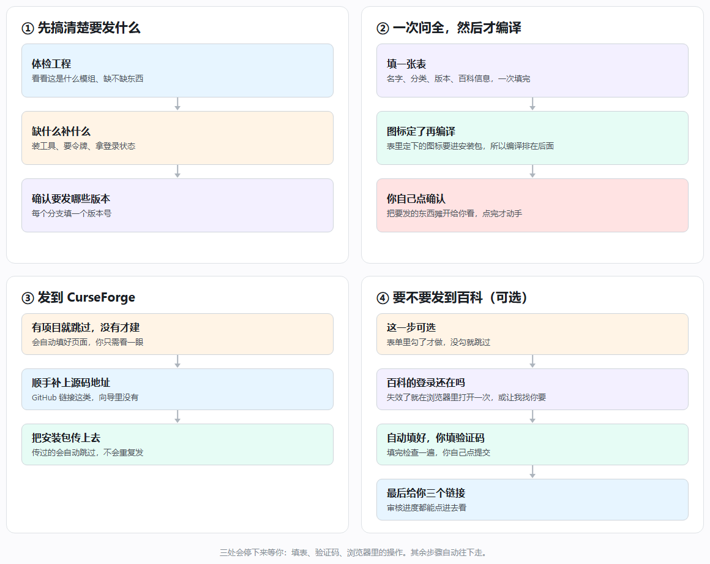

# 总流程图

## 四句话说明

1. **先搞清楚要发什么** —— 扫一遍工程，缺的东西当场补上
2. **一次问全，然后才编译** —— 名字、分类、版本、百科信息都放进一张表；表里定下的图标要进安装包，所以填完表才编译，编译完再让你点头
3. **发到 CurseForge** —— 有项目就跳过、没有才建，补上源码地址，把安装包传上去
4. **要不要发百科** —— 表单里勾了才做；先看百科的登录还在吗，失效了就在浏览器里点一下或让我找你要，然后自动填好，你填验证码后自己点提交

## 三处会停下来等你

- **填表**：表单不点提交，流程不会往下走
- **验证码**：百科提交需要，脚本取图，你认
- **浏览器里的操作**：传图标、建项目最后一步

其余步骤自动往下走，不需要你盯着。

## 想看细节

| 想知道什么 | 去哪看 |
|---|---|
| 具体命令、参数、失败怎么处理 | [执行手册](../SKILL.md) |
| 每一步留下什么文件 | [产物与数据流](workflow.md) |
| 建项目为什么先建后填 | [CurseForge 细节](curseforge.md#项目创建) |
| 百科怎么登录、怎么提交 | [百科细节](mcmod.md) |
| 报错了怎么办 | [踩坑记录](pitfalls.md) |
